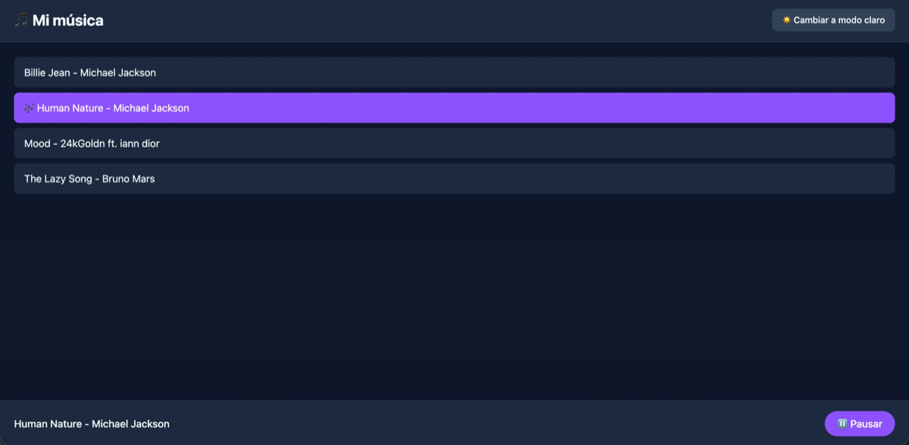

# 🎵 App de música

Aplicación web con una lista de canciones, un reproductor y modo claro/oscuro. La hice para practicar **Context API** de React: varios componentes que están en distintas partes de la pantalla comparten el mismo estado sin pasarse props de mano en mano.

**👉 Pruébala aquí: [musica-mario-vercel-app.vercel.app](https://musica-mario-vercel-app.vercel.app/)**



## ✨ Funcionalidades

- 🎶 Ver una **lista de canciones** (título y artista).
- 👆 **Elegir una canción** con un clic: queda **marcada** en la lista y aparece en el reproductor.
- ⏯️ **Pausar y reanudar** desde el reproductor.
- 🌙 Cambiar entre **modo claro y oscuro**: cambia los colores de **toda** la app.

## 🛠️ Tecnologías

- **React** (hooks: `useState` y `useContext`)
- **Context API**
- **JavaScript**
- **Vite**
- **Tailwind CSS**
- **Vercel** (deploy automático con cada `git push`)

## ⚙️ Cómo funciona

`App` guarda el estado y lo comparte por **dos contextos**, uno por tema:

| Contexto | Lo que comparte |
|---|---|
| `ModoContext` | `modoOscuro`, `setModoOscuro` |
| `ReproduccionContext` | `cancionActual`, `setCancionActual`, `estaSonando`, `setEstaSonando` |

```
App  (estado + los dos Provider)
 ├── Encabezado        → lee el modo y lo cambia con el botón
 ├── ListaCanciones    → recorre las canciones (importadas de datos/canciones.js)
 │    └── FilaCancion  → recibe su canción por props; lee y cambia la canción actual
 └── Reproductor       → lee la canción actual y si suena; pausa y reanuda
```

| Componente | Props | Contextos que lee |
|---|---|---|
| `Encabezado` | — | Modo |
| `ListaCanciones` | — | — |
| `FilaCancion` | `cancion` | Reproducción y modo |
| `Reproductor` | — | Reproducción y modo |

## 💡 Lo que aprendí

- **Context API:** crear un contexto (`createContext`), compartir el estado con el `Provider` y leerlo con `useContext` desde cualquier componente que esté dentro, aunque esté lejos de `App`.
- **Props, imports o Context:** usar props para lo que es distinto en cada hijo (la canción de cada fila), importar lo que es fijo (la lista de canciones) y Context para lo que necesitan muchos componentes lejanos (el modo y la canción actual).
- **Decidir qué leer del contexto:** cada componente saca solo lo que necesita para mostrar y lo que necesita para cambiar.
- **Renderizado condicional:** ternarios anidados para mostrar "Elige una canción" o el reproductor, el texto del botón y los colores de cada fila; y `?.` para no fallar cuando todavía no hay canción elegida.

## 🚀 Cómo correrlo en tu computador

```bash
git clone https://github.com/mariodinamarcap/musica.git
cd musica
npm install
npm run dev
```

Después abre `http://localhost:5173` en el navegador.

## 👤 Autor

**Mario Dinamarca** — [GitHub](https://github.com/mariodinamarcap)
